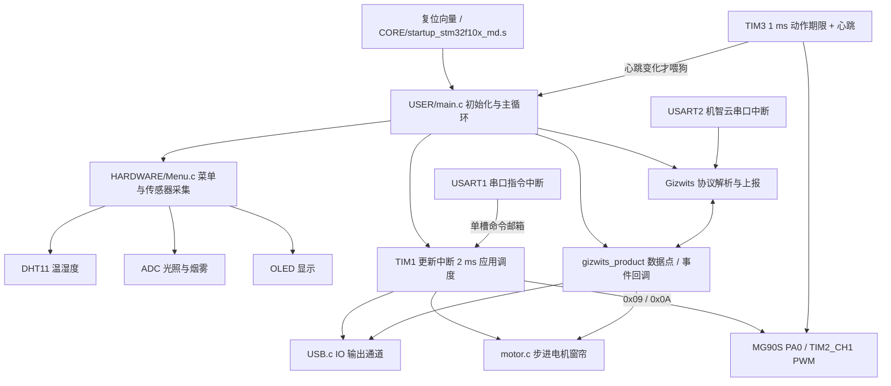

# STM32 程序目录索引

## 扫描范围

- 目标目录：stm32/程序
- 扫描时间：2026-09-25（Asia/Shanghai）
- 目录数：23 个子目录；文件数：288
- 工程入口：USER/STM32_CGMCU.uvprojx；Keil 工程直接引用文件 51 个。
- 文件清单包含源码、配置以及 Keil 中间产物和历史构建输出；二进制中间产物按扩展名和同名编译单元说明用途。

## 快速认识

该目录是一套以 Keil MDK 为入口的 STM32F10x 固件。USER/main.c 是应用入口；HARDWARE 负责板级驱动、OLED 菜单和 MG90S 舵机；SYSTEM 提供定时器、ADC、串口和延时；Gizwits 与 Utils 负责机智云数据点和协议；CORE 与 STM32F10x_FWLib 提供 Cortex-M3 启动及外设库。新舵机接口为固定 OPEN/CLOSE 命令，完整改动与限制见 [舵机集成记录](SERVO_INTEGRATION.md)。

工程配置已恢复为原硬件型号 STM32F103C6，链接内存限制为 32 KB Flash / 10 KB RAM；代码保留 DHT11、ADC 光照/烟雾采集、窗帘步进电机和机智云数据点，并仅在软件中加入 PA0/TIM2_CH1 的 MG90S PWM 驱动。本轮只修正固件目标和代码调度，不改硬件型号。固件尚无舵机位置反馈，旧 USART1 协议也没有与上层 request_id 关联的 ACK/TTL，因此这不是端到端设备安全闭环。项目资料对窗户范围存在冲突：根级开发约定和根 README 将 28BYJ 窗户列入当前硬件，架构决策记录和版本三规格则写不包含窗户；架构决策与规格也写明不包含光照传感器，而本目录存在光照 ADC 代码。具体差异见文末“当前源码边界与静态待核对项”。

## 关联资料

- [当前架构决策记录](../../docs/02-技术方案/智能家居当前架构决策记录.md)
- [项目根 README](../../readme.md)
- [版本三功能与硬件规格](../../docs/02-技术方案/智能家电版本三功能与硬件规格.md)
- [独立舵机门台架工程](../servo_door/README.md)
- [MG90S 集成开发记录与验证](SERVO_INTEGRATION.md)

## 目录结构

```text
stm32/程序/
  CORE/
  Gizwits/
  HARDWARE/
    DHT11/
    LED/
    motor/
    OLED/
    Servo/
  STM32F10x_FWLib/
    inc/
    src/
  SYSTEM/
    ADCX/
    delay/
    sys/
    TIM2/
    usart/
  tests/
  USER/
    DebugConfig/
    Listings/
    Objects/
  Utils/
```

## 子目录职责

| 子目录 | 内容 |
|---|---|
| <code>CORE/</code> | Cortex-M3 CMSIS 内核代码、启动向量和复位入口。 |
| <code>Gizwits/</code> | 机智云数据点适配与 MCU 通信协议。 |
| <code>HARDWARE/</code> | 板级驱动、OLED 菜单和执行器控制。 |
| <code>HARDWARE/DHT11/</code> | DHT11 温湿度传感器驱动。 |
| <code>HARDWARE/LED/</code> | 板载 LED 驱动。 |
| <code>HARDWARE/motor/</code> | 电机相关目录，内含 DHT11 驱动副本。 |
| <code>HARDWARE/OLED/</code> | OLED 显示驱动与字模。 |
| <code>HARDWARE/Servo/</code> | MG90S 定时器 PWM 驱动与独立动作倒计时逻辑。 |
| <code>STM32F10x_FWLib/</code> | ST STM32F10x 标准外设库。 |
| <code>STM32F10x_FWLib/inc/</code> | 标准外设库 API 头文件。 |
| <code>STM32F10x_FWLib/src/</code> | 标准外设库外设 API 实现。 |
| <code>SYSTEM/</code> | 定时器、ADC、串口、延时与系统辅助服务。 |
| <code>SYSTEM/ADCX/</code> | ADC1 初始化与通道采样。 |
| <code>SYSTEM/delay/</code> | SysTick 延时函数。 |
| <code>SYSTEM/sys/</code> | WFI 和中断辅助函数。 |
| <code>SYSTEM/TIM2/</code> | 应用定时中断与控制逻辑。 |
| <code>SYSTEM/usart/</code> | USART 初始化、中断接收和命令处理。 |
| <code>tests/</code> | MG90S、阈值、DHT11、ADC 与机智云协议的主机 C 行为测试及 MSVC 运行脚本。 |
| <code>USER/</code> | Keil 工程、应用入口、CMSIS 设备配置与生成目录。 |
| <code>USER/DebugConfig/</code> | Keil 调试目标配置。 |
| <code>USER/Listings/</code> | 汇编清单与链接映射报告。 |
| <code>USER/Objects/</code> | Keil 编译、链接和 IDE 中间产物。 |
| <code>Utils/</code> | 机智云编码工具和环形缓冲区。 |

## 文件类型统计

| 扩展名 | 数量 | 类型 |
|---|---:|---|
| .h | 54 | C 头文件 |
| .c | 52 | C 源码 |
| .cmd | 1 | MSVC 主机测试运行脚本 |
| .d | 51 | 依赖清单 |
| .o | 51 | 目标文件 |
| .crf | 50 | 交叉引用中间文件 |
| .dbgconf | 4 | 调试配置 |
| .htm | 2 | HTML 报告/日志 |
| .axf | 1 | ARM 可执行映像 |
| .sooyaaa | 1 | Keil uVision 用户界面状态（uvguix 用户后缀） |
| .scvd | 1 | 事件描述配置 |
| .sct | 1 | scatter 内存布局 |
| .s | 1 | ARM 汇编 |
| .mmd | 1 | Mermaid 源图 |
| .md | 2 | Markdown 文档 |
| .map | 1 | 链接映射 |
| .kevinflyn | 1 | Keil uVision 用户界面状态（uvguix 用户后缀） |
| .lnp | 1 | 链接参数文件 |
| .uvoptx | 1 | Keil 用户选项 |
| .iex | 1 | IDE 扩展状态文件 |
| .hex | 1 | Intel HEX 固件 |
| .bin | 1 | 原始二进制固件 |
| .dep | 2 | Keil 依赖数据库 |
| .dengbuhao | 1 | Keil uVision 用户界面状态（uvguix 用户后缀） |
| .bak | 1 | 备份文件 |
| .lst | 1 | 汇编清单 |
| .uvprojx | 1 | Keil 工程 |

## 模块调用关系



### 主要运行链路

- 启动汇编的复位入口进入系统时钟初始化，再进入 USER/main.c。
- 主循环每秒调用 `Menu_UpdateSensors()` 采集 DHT11 与 ADC；各 OLED 页面只显示最近一次有效数据或无效标记。
- TIM1 每 2 ms 扫描按键并记录配网事件；主循环处理串口命令、自动阈值控制和配网。TIM2 专用于 PA0 舵机 PWM；USB.c 控制 IO 输出，motor.c 驱动窗帘步进电机。
- TIM3 以 1 ms 节拍推进舵机动作期限，并递增心跳；主循环只在观察到新心跳后喂独立看门狗。
- USART1 中断处理串口指令；USART2 与机智云协议收发相关。主循环调用 userHandle() 准备数据点，再调用 gizwitsHandle() 处理协议。
- STM32F10x_FWLib 是 ST 标准外设库；Utils 提供机智云编码和环形缓冲工具。

## 重要代码片段定位

| 模块 | 重要代码片段 / 快速定位 |
|---|---|
| 启动与主循环 | [main()](USER/main.c#L40)、[系统初始化](USER/main.c#L44)、[菜单状态机](USER/main.c#L78)、[机智云轮询](USER/main.c#L305) |
| 菜单与采样 | [Menu_UpdateSensors()](HARDWARE/Menu.c)、[Menu1()](HARDWARE/Menu.c)、[设备切换](HARDWARE/Menu.c) |
| 定时与自动控制 | [TIM1 更新中断及 HomeControl_Process()](SYSTEM/TIM2/TIM2.c) |
| MG90S 舵机 | [驱动初始化与 PWM](HARDWARE/Servo/MG90S.c#L114)、[动作状态机](HARDWARE/Servo/MG90S_logic.c#L3)、[命令号](HARDWARE/Servo/MG90S.h#L6)、[TIM3 1 ms 节拍](SYSTEM/TIM3.c#L61) |
| 串口 | [USART1 初始化](SYSTEM/usart/usart.c#L51)、[USART2 初始化](SYSTEM/usart/usart.c#L92)、[USART1 接收](SYSTEM/usart/usart.c#L175)、[USART2 接收](SYSTEM/usart/usart.c#L225) |
| 机智云 | [事件处理](Gizwits/gizwits_product.c#L54)、[数据点更新](Gizwits/gizwits_product.c#L228)、[协议初始化](Gizwits/gizwits_protocol.c#L1300)、[协议主处理](Gizwits/gizwits_protocol.c#L1520) |
| 硬件驱动 | [DHT11 读取](HARDWARE/DHT11/dht11.c#L93)、[ADC 采样](SYSTEM/ADCX/ADCX.c#L37)、[按键扫描](HARDWARE/Key.c#L36)、[输出控制](HARDWARE/USB.c#L17)、[电机角度](HARDWARE/motor.c#L145) |
| 协议工具 | [数据点压缩](Utils/dataPointTools.c#L172)、[解压](Utils/dataPointTools.c#L212)、[环形缓冲区读取](Utils/ringbuffer.c#L85) |

## 当前源码边界与静态待核对项

1. 工程 Target/Device 已配置为 `SmartHome_STM32F103C6` / STM32F103C6，链接器上限为 32 KB Flash / 10 KB RAM。目录仍保留旧机智云、传感器和步进电机逻辑；窗口执行器范围存在文档冲突：根级开发约定和根 README 包含 28BYJ 窗户，架构决策记录与版本三规格写不包含；后二者也排除光照传感器。实物组合仍须按当前项目决定核对。
2. 采集位置：HARDWARE/Menu.c 的 `Menu_UpdateSensors()` 读取 DHT11、ADC 通道 5（光照）和通道 4（烟雾）；HARDWARE/LDR.c 当前为 0 字节，虽然仍列入 Keil 工程。ADC 读取实现位于 SYSTEM/ADCX/ADCX.c。
3. 重复驱动：HARDWARE/motor/dht11.c 是旧副本，Keil 工程只引用 HARDWARE/DHT11/dht11.c；后者已增加超时和校验失败反馈。
4. 机智云窗帘事件现与主循环统一使用标志值 1；APP 与实物动作仍需联调确认。
5. 舵机边界：MG90S 使用开门 1600 µs、关门 1400 µs 的初始校准值，持续输出上限 1000 ms；这些值不是实物角度标定。沿用现有合规电源轨并与 STM32 共地，不新增电源模块或下拉电阻；原板供电能力需查资料确认。缺少位置/门磁反馈，不能把命令回执解释为门体到位。
6. 上层协议边界：USART1 保留原有单槽命令邮箱和帧解析，无 `request_id`、设备端绝对 TTL 或执行 ACK；高速连续帧或中断长延时期间可能覆盖待处理命令。与固定工具、注册设备、在线状态、过期校验、QoS 1 和结构化回执的桥接仍需单独实现。
7. 2026-09-27 验证：阈值、MG90S、DHT11、ADC 与机智云主机 C 行为测试通过；Keil 目标 `SmartHome_STM32F103C6` 构建为 0 errors、0 warnings，Code 26060 B、RO-data 2972 B。尚未烧录、抓取串口波形或完成 APP/实物联调。

## 全量文件索引

以下清单在扫描时覆盖目标目录内的全部普通文件及子目录，路径相对于 stm32/程序。列表中的二进制产物按类型摘要，没有把二进制内容当作源码。

| 相对路径 | 文件类型 | 核心功能 / 内容摘要 | Keil 工程直接引用 | 代码定位标记 |
|---|---|---|---|---|
| <code>调用关系图.mmd</code> | Mermaid 源图 | Mermaid 模块调用关系图源文件。 | 否 | — |
| <code>项目索引.md</code> | Markdown 文档 | 目录索引文档。 | 否 | — |
| <code>SERVO_INTEGRATION.md</code> | Markdown 文档 | MG90S 集成选型、架构、代码改动、验证结果、烧录接线与研究结论边界。 | 否 | — |
| <code>CORE/core_cm3.c</code> | C 源码 | ARM Cortex-M3 CMSIS 内核函数实现，提供寄存器、位操作及独占访问等底层支持。 | 是 | — |
| <code>CORE/core_cm3.h</code> | C 头文件 | ARM Cortex-M3 内核寄存器、异常、NVIC、SysTick 与内联函数定义。 | 否 | — |
| <code>CORE/startup_stm32f10x_md.s</code> | ARM 汇编 | 中容量 STM32F10x 启动汇编：中断向量表、复位入口及弱中断处理器。 | 是 | — |
| <code>Gizwits/gizwits_product.c</code> | C 源码 | 机智云产品适配：数据点事件映射、设备输出、状态上报及串口写入。 | 是 | [事件回调](Gizwits/gizwits_product.c#L54) · [数据点更新](Gizwits/gizwits_product.c#L228) |
| <code>Gizwits/gizwits_product.h</code> | C 头文件 | 机智云产品适配接口声明。 | 否 | — |
| <code>Gizwits/gizwits_protocol.c</code> | C 源码 | 机智云 MCU 协议引擎：帧处理、数据点打包/解析、状态同步和透传。 | 是 | [协议初始化](Gizwits/gizwits_protocol.c#L1300) · [主处理](Gizwits/gizwits_protocol.c#L1520) |
| <code>Gizwits/gizwits_protocol.h</code> | C 头文件 | 机智云协议结构、事件编号、状态类型、缓冲区和公开 API。 | 否 | — |
| <code>HARDWARE/Buzzer.c</code> | C 源码 | 蜂鸣器 GPIO 初始化、开启和关闭。 | 是 | — |
| <code>HARDWARE/Buzzer.h</code> | C 头文件 | 蜂鸣器引脚宏及驱动接口。 | 否 | — |
| <code>HARDWARE/DHT11/dht11.c</code> | C 源码 | DHT11 单总线时序驱动，读取湿度和温度。 | 是 | [DHT11读取](HARDWARE/DHT11/dht11.c#L93) |
| <code>HARDWARE/DHT11/dht11.h</code> | C 头文件 | DHT11 初始化与温湿度读取接口。 | 否 | — |
| <code>HARDWARE/IWDG.c</code> | C 源码 | 独立看门狗初始化。 | 是 | — |
| <code>HARDWARE/IWDG.h</code> | C 头文件 | 独立看门狗初始化接口。 | 否 | — |
| <code>HARDWARE/Key.c</code> | C 源码 | 按键 GPIO 初始化与扫描，生成共享按键状态。 | 是 | [按键扫描](HARDWARE/Key.c#L36) |
| <code>HARDWARE/Key.h</code> | C 头文件 | 按键编号、共享状态和初始化/扫描接口。 | 否 | — |
| <code>HARDWARE/LDR.c</code> | C 源码 | 空文件（0 字节）；当前光照 ADC 采集位于 Menu.c，工程文件仍列入此源文件。 | 是 | — |
| <code>HARDWARE/LDR.h</code> | C 头文件 | 光敏电阻/烟雾传感器旧引脚声明，部分宏已注释。 | 否 | — |
| <code>HARDWARE/LED/led.c</code> | C 源码 | Keil 工程配置或构建辅助文件。 | 是 | — |
| <code>HARDWARE/LED/led.h</code> | C 头文件 | Keil 工程配置或构建辅助文件。 | 否 | — |
| <code>HARDWARE/Menu.c</code> | C 源码 | OLED 页面、独立周期采样入口和设备切换控制。 | 是 | [菜单/采样](HARDWARE/Menu.c) |
| <code>HARDWARE/Menu.h</code> | C 头文件 | 菜单函数、传感器状态变量和设备页面控制接口。 | 否 | — |
| <code>HARDWARE/motor.c</code> | C 源码 | 步进电机相序、方向、角度和停止控制；当前应用用于窗帘动作。 | 是 | [角度控制](HARDWARE/motor.c#L145) |
| <code>HARDWARE/motor.h</code> | C 头文件 | 步进电机 GPIO/相序定义及驱动接口。 | 否 | — |
| <code>HARDWARE/motor/dht11.c</code> | C 源码 | 旧 DHT11 驱动副本；当前工程使用 HARDWARE/DHT11/ 下的实现。 | 否 | — |
| <code>HARDWARE/motor/dht11.h</code> | C 头文件 | 旧 DHT11 驱动头文件；当前工程未列入此目录。 | 否 | — |
| <code>HARDWARE/OLED/OLED_Font.h</code> | C 头文件 | OLED 字符和中文点阵字模数据。 | 否 | — |
| <code>HARDWARE/OLED/OLED.c</code> | C 源码 | OLED 软件 I2C、命令/数据传输、清屏及字符/数字/汉字绘制。 | 是 | — |
| <code>HARDWARE/OLED/OLED.h</code> | C 头文件 | OLED 绘制与初始化接口。 | 否 | — |
| <code>HARDWARE/Servo/MG90S.c</code> | C 源码 | PA0/TIM2_CH1 的 50 Hz 舵机 PWM、动作限时、无毛刺方向切换和时钟有效性检查。 | 是 | [驱动初始化](HARDWARE/Servo/MG90S.c#L114) · [动作期限](HARDWARE/Servo/MG90S.c#L171) |
| <code>HARDWARE/Servo/MG90S.h</code> | C 头文件 | MG90S 初始化、开/关控制接口及固定命令号 0x09/0x0A。 | 否 | [固定命令号](HARDWARE/Servo/MG90S.h#L6) |
| <code>HARDWARE/Servo/MG90S_logic.c</code> | C 源码 | 舵机 OPEN/CLOSE/OFF 状态转换与 1000 ms 动作倒计时纯逻辑。 | 是 | [逻辑状态机](HARDWARE/Servo/MG90S_logic.c#L3) |
| <code>HARDWARE/Servo/MG90S_logic.h</code> | C 头文件 | 舵机逻辑状态结构、固定动作期限和目标状态枚举。 | 否 | — |
| <code>HARDWARE/USB.c</code> | C 源码 | 按通道控制 GPIO 输出；调用方将通道用于灯光、风扇等负载。 | 是 | [输出控制](HARDWARE/USB.c#L17) |
| <code>HARDWARE/USB.h</code> | C 头文件 | 输出通道初始化、开启与关闭接口。 | 否 | — |
| <code>STM32F10x_FWLib/inc/misc.h</code> | C 头文件 | ST STM32F10x 标准外设库 NVIC 中断优先级辅助 API 与配置结构声明。 | 否 | — |
| <code>STM32F10x_FWLib/inc/stm32f10x_adc.h</code> | C 头文件 | ST STM32F10x 标准外设库 模数转换 ADC API 与配置结构声明。 | 否 | — |
| <code>STM32F10x_FWLib/inc/stm32f10x_bkp.h</code> | C 头文件 | ST STM32F10x 标准外设库 备份寄存器 BKP API 与配置结构声明。 | 否 | — |
| <code>STM32F10x_FWLib/inc/stm32f10x_can.h</code> | C 头文件 | ST STM32F10x 标准外设库 CAN 控制器 API 与配置结构声明。 | 否 | — |
| <code>STM32F10x_FWLib/inc/stm32f10x_cec.h</code> | C 头文件 | ST STM32F10x 标准外设库 CEC 控制器 API 与配置结构声明。 | 否 | — |
| <code>STM32F10x_FWLib/inc/stm32f10x_crc.h</code> | C 头文件 | ST STM32F10x 标准外设库 CRC 计算单元 API 与配置结构声明。 | 否 | — |
| <code>STM32F10x_FWLib/inc/stm32f10x_dac.h</code> | C 头文件 | ST STM32F10x 标准外设库 数模转换 DAC API 与配置结构声明。 | 否 | — |
| <code>STM32F10x_FWLib/inc/stm32f10x_dbgmcu.h</code> | C 头文件 | ST STM32F10x 标准外设库 调试控制器 DBGMCU API 与配置结构声明。 | 否 | — |
| <code>STM32F10x_FWLib/inc/stm32f10x_dma.h</code> | C 头文件 | ST STM32F10x 标准外设库 直接存储器访问 DMA API 与配置结构声明。 | 否 | — |
| <code>STM32F10x_FWLib/inc/stm32f10x_exti.h</code> | C 头文件 | ST STM32F10x 标准外设库 外部中断 EXTI API 与配置结构声明。 | 否 | — |
| <code>STM32F10x_FWLib/inc/stm32f10x_flash.h</code> | C 头文件 | ST STM32F10x 标准外设库 片上 Flash API 与配置结构声明。 | 否 | — |
| <code>STM32F10x_FWLib/inc/stm32f10x_fsmc.h</code> | C 头文件 | ST STM32F10x 标准外设库 静态存储器控制器 FSMC API 与配置结构声明。 | 否 | — |
| <code>STM32F10x_FWLib/inc/stm32f10x_gpio.h</code> | C 头文件 | ST STM32F10x 标准外设库 通用输入输出 GPIO API 与配置结构声明。 | 否 | — |
| <code>STM32F10x_FWLib/inc/stm32f10x_i2c.h</code> | C 头文件 | ST STM32F10x 标准外设库 I2C 总线控制器 API 与配置结构声明。 | 否 | — |
| <code>STM32F10x_FWLib/inc/stm32f10x_iwdg.h</code> | C 头文件 | ST STM32F10x 标准外设库 独立看门狗 IWDG API 与配置结构声明。 | 否 | — |
| <code>STM32F10x_FWLib/inc/stm32f10x_pwr.h</code> | C 头文件 | ST STM32F10x 标准外设库 电源控制 PWR API 与配置结构声明。 | 否 | — |
| <code>STM32F10x_FWLib/inc/stm32f10x_rcc.h</code> | C 头文件 | ST STM32F10x 标准外设库 复位与时钟控制 RCC API 与配置结构声明。 | 否 | — |
| <code>STM32F10x_FWLib/inc/stm32f10x_rtc.h</code> | C 头文件 | ST STM32F10x 标准外设库 实时时钟 RTC API 与配置结构声明。 | 否 | — |
| <code>STM32F10x_FWLib/inc/stm32f10x_sdio.h</code> | C 头文件 | ST STM32F10x 标准外设库 SDIO 接口 API 与配置结构声明。 | 否 | — |
| <code>STM32F10x_FWLib/inc/stm32f10x_spi.h</code> | C 头文件 | ST STM32F10x 标准外设库 SPI 总线控制器 API 与配置结构声明。 | 否 | — |
| <code>STM32F10x_FWLib/inc/stm32f10x_tim.h</code> | C 头文件 | ST STM32F10x 标准外设库 定时器 TIM API 与配置结构声明。 | 否 | — |
| <code>STM32F10x_FWLib/inc/stm32f10x_usart.h</code> | C 头文件 | ST STM32F10x 标准外设库 USART/UART 串口控制器 API 与配置结构声明。 | 否 | — |
| <code>STM32F10x_FWLib/inc/stm32f10x_wwdg.h</code> | C 头文件 | ST STM32F10x 标准外设库 窗口看门狗 WWDG API 与配置结构声明。 | 否 | — |
| <code>STM32F10x_FWLib/src/misc.c</code> | C 源码 | ST STM32F10x 标准外设库 NVIC 中断优先级辅助 API 底层实现。 | 是 | — |
| <code>STM32F10x_FWLib/src/stm32f10x_adc.c</code> | C 源码 | ST STM32F10x 标准外设库 模数转换 ADC API 底层实现。 | 是 | — |
| <code>STM32F10x_FWLib/src/stm32f10x_bkp.c</code> | C 源码 | ST STM32F10x 标准外设库 备份寄存器 BKP API 底层实现。 | 是 | — |
| <code>STM32F10x_FWLib/src/stm32f10x_can.c</code> | C 源码 | ST STM32F10x 标准外设库 CAN 控制器 API 底层实现。 | 是 | — |
| <code>STM32F10x_FWLib/src/stm32f10x_cec.c</code> | C 源码 | ST STM32F10x 标准外设库 CEC 控制器 API 底层实现。 | 是 | — |
| <code>STM32F10x_FWLib/src/stm32f10x_crc.c</code> | C 源码 | ST STM32F10x 标准外设库 CRC 计算单元 API 底层实现。 | 是 | — |
| <code>STM32F10x_FWLib/src/stm32f10x_dac.c</code> | C 源码 | ST STM32F10x 标准外设库 数模转换 DAC API 底层实现。 | 是 | — |
| <code>STM32F10x_FWLib/src/stm32f10x_dbgmcu.c</code> | C 源码 | ST STM32F10x 标准外设库 调试控制器 DBGMCU API 底层实现。 | 是 | — |
| <code>STM32F10x_FWLib/src/stm32f10x_dma.c</code> | C 源码 | ST STM32F10x 标准外设库 直接存储器访问 DMA API 底层实现。 | 是 | — |
| <code>STM32F10x_FWLib/src/stm32f10x_exti.c</code> | C 源码 | ST STM32F10x 标准外设库 外部中断 EXTI API 底层实现。 | 是 | — |
| <code>STM32F10x_FWLib/src/stm32f10x_flash.c</code> | C 源码 | ST STM32F10x 标准外设库 片上 Flash API 底层实现。 | 是 | — |
| <code>STM32F10x_FWLib/src/stm32f10x_fsmc.c</code> | C 源码 | ST STM32F10x 标准外设库 静态存储器控制器 FSMC API 底层实现。 | 是 | — |
| <code>STM32F10x_FWLib/src/stm32f10x_gpio.c</code> | C 源码 | ST STM32F10x 标准外设库 通用输入输出 GPIO API 底层实现。 | 是 | — |
| <code>STM32F10x_FWLib/src/stm32f10x_i2c.c</code> | C 源码 | ST STM32F10x 标准外设库 I2C 总线控制器 API 底层实现。 | 是 | — |
| <code>STM32F10x_FWLib/src/stm32f10x_iwdg.c</code> | C 源码 | ST STM32F10x 标准外设库 独立看门狗 IWDG API 底层实现。 | 是 | — |
| <code>STM32F10x_FWLib/src/stm32f10x_pwr.c</code> | C 源码 | ST STM32F10x 标准外设库 电源控制 PWR API 底层实现。 | 是 | — |
| <code>STM32F10x_FWLib/src/stm32f10x_rcc.c</code> | C 源码 | ST STM32F10x 标准外设库 复位与时钟控制 RCC API 底层实现。 | 是 | — |
| <code>STM32F10x_FWLib/src/stm32f10x_rtc.c</code> | C 源码 | ST STM32F10x 标准外设库 实时时钟 RTC API 底层实现。 | 是 | — |
| <code>STM32F10x_FWLib/src/stm32f10x_sdio.c</code> | C 源码 | ST STM32F10x 标准外设库 SDIO 接口 API 底层实现。 | 是 | — |
| <code>STM32F10x_FWLib/src/stm32f10x_spi.c</code> | C 源码 | ST STM32F10x 标准外设库 SPI 总线控制器 API 底层实现。 | 是 | — |
| <code>STM32F10x_FWLib/src/stm32f10x_tim.c</code> | C 源码 | ST STM32F10x 标准外设库 定时器 TIM API 底层实现。 | 是 | — |
| <code>STM32F10x_FWLib/src/stm32f10x_usart.c</code> | C 源码 | ST STM32F10x 标准外设库 USART/UART 串口控制器 API 底层实现。 | 是 | — |
| <code>STM32F10x_FWLib/src/stm32f10x_wwdg.c</code> | C 源码 | ST STM32F10x 标准外设库 窗口看门狗 WWDG API 底层实现。 | 是 | — |
| <code>SYSTEM/ADCX/ADCX.c</code> | C 源码 | ADC1 初始化和指定通道单次转换读取。 | 是 | [ADC采样](SYSTEM/ADCX/ADCX.c#L37) |
| <code>SYSTEM/ADCX/ADCX.h</code> | C 头文件 | ADC1 初始化与通道读数接口。 | 否 | — |
| <code>SYSTEM/delay/delay.c</code> | C 源码 | SysTick 微秒/毫秒延时实现。 | 是 | — |
| <code>SYSTEM/delay/delay.h</code> | C 头文件 | SysTick 延时函数声明。 | 否 | — |
| <code>SYSTEM/sys.h</code> | C 头文件 | 系统通用类型、外设基础头文件和系统级定义。 | 否 | — |
| <code>SYSTEM/sys/sys.c</code> | C 源码 | WFI、全局中断开关等 Cortex-M 系统辅助函数。 | 是 | — |
| <code>SYSTEM/sys/sys.h</code> | C 头文件 | 系统辅助函数声明及位操作宏。 | 否 | — |
| <code>SYSTEM/TIM2/TIM2.c</code> | C 源码 | TIM1 中断扫描按键并记录配网事件，主循环调用控制函数处理命令和自动模式；路径名保留旧名。 | 是 | [TIM1 中断与控制函数](SYSTEM/TIM2/TIM2.c) |
| <code>SYSTEM/TIM2/TIM2.h</code> | C 头文件 | TIM1 应用调度初始化接口声明（文件名保留旧名）。 | 否 | — |
| <code>SYSTEM/TIM3.c</code> | C 源码 | TIM3 1 ms 中断，推进机智云计时与舵机期限，并更新主循环看门狗心跳。 | 是 | [1 ms 中断处理](SYSTEM/TIM3.c#L61) |
| <code>SYSTEM/TIM3.h</code> | C 头文件 | TIM3 初始化/中断与毫秒心跳变量声明。 | 否 | — |
| <code>SYSTEM/usart/usart.c</code> | C 源码 | USART1/USART2 初始化与接收中断；USART1 处理串口命令并更新单槽邮箱，USART2 接机智云协议。 | 是 | [USART1 ISR](SYSTEM/usart/usart.c#L175) · [USART2 ISR](SYSTEM/usart/usart.c#L225) |
| <code>SYSTEM/usart/usart.h</code> | C 头文件 | USART 初始化、接收状态及命令变量声明。 | 否 | — |
| <code>USER/DebugConfig/DHT11_STM32F103C6_1.0.0.dbgconf</code> | 调试配置 | Keil/CMSIS-DAP 调试器目标配置。 | 否 | — |
| <code>USER/DebugConfig/DHT11_STM32F103C8_1.0.0.dbgconf</code> | 调试配置 | 目录中遗留的 C8 命名 DHT11 目标配置；不是当前 C6 SmartHome Target 的活动配置。 | 否 | — |
| <code>USER/DebugConfig/SmartHome_STM32F103C6_STM32F103C6_1.0.0.dbgconf</code> | 调试配置 | 当前 STM32F103C6 SmartHome Keil Target 调试器配置。 | 否 | — |
| <code>USER/DebugConfig/Target_1_STM32F103C8_1.0.0.dbgconf</code> | 调试配置 | 目录中遗留的 C8 命名调试配置；不是当前 C6 SmartHome Target 的活动配置。 | 否 | — |
| <code>USER/EventRecorderStub.scvd</code> | 事件描述配置 | Keil Event Recorder / System Viewer 事件描述配置。 | 否 | — |
| <code>USER/Listings/startup_stm32f10x_md.lst</code> | 汇编清单 | 汇编器生成的启动文件清单，含地址、指令和符号。 | 否 | — |
| <code>USER/Listings/STM32_CGMCU.map</code> | 链接映射 | 链接器生成的内存布局、符号引用与代码占用映射报告。 | 否 | — |
| <code>USER/main.c</code> | C 源码 | 应用入口：外设初始化、OLED 菜单状态机、步进电机动作及机智云数据点轮询；看门狗喂养依赖 TIM3 心跳。 | 是 | [入口](USER/main.c#L40) · [初始化](USER/main.c#L44) · [机智云轮询](USER/main.c#L305) |
| <code>tests/run_mg90s_logic.cmd</code> | Windows 命令脚本 | 使用 MSVC 编译并运行 MG90S 纯逻辑测试，输出放在系统临时目录。 | 否 | — |
| <code>tests/test_mg90s_logic.c</code> | C 主机测试 | 验证舵机状态转换、动作期限、重复命令和非法目标处理。 | 否 | — |
| <code>USER/Objects/adcx.crf</code> | 交叉引用中间文件 | Keil C 符号交叉引用数据库。 | 否 | — |
| <code>USER/Objects/adcx.d</code> | 依赖清单 | 编译器生成的头文件依赖清单。 | 否 | — |
| <code>USER/Objects/adcx.o</code> | 目标文件 | Keil/ARM 编译目标文件，对应编译单元 adcx。 | 否 | — |
| <code>USER/Objects/buzzer.crf</code> | 交叉引用中间文件 | Keil C 符号交叉引用数据库。 | 否 | — |
| <code>USER/Objects/buzzer.d</code> | 依赖清单 | 编译器生成的头文件依赖清单。 | 否 | — |
| <code>USER/Objects/buzzer.o</code> | 目标文件 | Keil/ARM 编译目标文件，对应编译单元 buzzer。 | 否 | — |
| <code>USER/Objects/common.crf</code> | 交叉引用中间文件 | Keil C 符号交叉引用数据库。 | 否 | — |
| <code>USER/Objects/common.d</code> | 依赖清单 | 编译器生成的头文件依赖清单。 | 否 | — |
| <code>USER/Objects/common.o</code> | 目标文件 | Keil/ARM 编译目标文件，对应编译单元 common。 | 否 | — |
| <code>USER/Objects/core_cm3.crf</code> | 交叉引用中间文件 | Keil C 符号交叉引用数据库。 | 否 | — |
| <code>USER/Objects/core_cm3.d</code> | 依赖清单 | 编译器生成的头文件依赖清单。 | 否 | — |
| <code>USER/Objects/core_cm3.o</code> | 目标文件 | Keil/ARM 编译目标文件，对应编译单元 core_cm3。 | 否 | — |
| <code>USER/Objects/datapointtools.crf</code> | 交叉引用中间文件 | Keil C 符号交叉引用数据库。 | 否 | — |
| <code>USER/Objects/datapointtools.d</code> | 依赖清单 | 编译器生成的头文件依赖清单。 | 否 | — |
| <code>USER/Objects/datapointtools.o</code> | 目标文件 | Keil/ARM 编译目标文件，对应编译单元 datapointtools。 | 否 | — |
| <code>USER/Objects/delay.crf</code> | 交叉引用中间文件 | Keil C 符号交叉引用数据库。 | 否 | — |
| <code>USER/Objects/delay.d</code> | 依赖清单 | 编译器生成的头文件依赖清单。 | 否 | — |
| <code>USER/Objects/delay.o</code> | 目标文件 | Keil/ARM 编译目标文件，对应编译单元 delay。 | 否 | — |
| <code>USER/Objects/dht11.crf</code> | 交叉引用中间文件 | Keil C 符号交叉引用数据库。 | 否 | — |
| <code>USER/Objects/dht11.d</code> | 依赖清单 | 编译器生成的头文件依赖清单。 | 否 | — |
| <code>USER/Objects/dht11.o</code> | 目标文件 | Keil/ARM 编译目标文件，对应编译单元 dht11。 | 否 | — |
| <code>USER/Objects/ExtDll.iex</code> | IDE 扩展状态文件 | Keil 外部调试扩展状态记录。 | 否 | — |
| <code>USER/Objects/gizwits_product.crf</code> | 交叉引用中间文件 | Keil C 符号交叉引用数据库。 | 否 | — |
| <code>USER/Objects/gizwits_product.d</code> | 依赖清单 | 编译器生成的头文件依赖清单。 | 否 | — |
| <code>USER/Objects/gizwits_product.o</code> | 目标文件 | Keil/ARM 编译目标文件，对应编译单元 gizwits_product。 | 否 | — |
| <code>USER/Objects/gizwits_protocol.crf</code> | 交叉引用中间文件 | Keil C 符号交叉引用数据库。 | 否 | — |
| <code>USER/Objects/gizwits_protocol.d</code> | 依赖清单 | 编译器生成的头文件依赖清单。 | 否 | — |
| <code>USER/Objects/gizwits_protocol.o</code> | 目标文件 | Keil/ARM 编译目标文件，对应编译单元 gizwits_protocol。 | 否 | — |
| <code>USER/Objects/iwdg.crf</code> | 交叉引用中间文件 | Keil C 符号交叉引用数据库。 | 否 | — |
| <code>USER/Objects/iwdg.d</code> | 依赖清单 | 编译器生成的头文件依赖清单。 | 否 | — |
| <code>USER/Objects/iwdg.o</code> | 目标文件 | Keil/ARM 编译目标文件，对应编译单元 iwdg。 | 否 | — |
| <code>USER/Objects/key.crf</code> | 交叉引用中间文件 | Keil C 符号交叉引用数据库。 | 否 | — |
| <code>USER/Objects/key.d</code> | 依赖清单 | 编译器生成的头文件依赖清单。 | 否 | — |
| <code>USER/Objects/key.o</code> | 目标文件 | Keil/ARM 编译目标文件，对应编译单元 key。 | 否 | — |
| <code>USER/Objects/ldr.crf</code> | 交叉引用中间文件 | Keil C 符号交叉引用数据库。 | 否 | — |
| <code>USER/Objects/ldr.d</code> | 依赖清单 | 编译器生成的头文件依赖清单。 | 否 | — |
| <code>USER/Objects/ldr.o</code> | 目标文件 | Keil/ARM 编译目标文件，对应编译单元 ldr。 | 否 | — |
| <code>USER/Objects/led.crf</code> | 交叉引用中间文件 | Keil C 符号交叉引用数据库。 | 否 | — |
| <code>USER/Objects/led.d</code> | 依赖清单 | 编译器生成的头文件依赖清单。 | 否 | — |
| <code>USER/Objects/led.o</code> | 目标文件 | Keil/ARM 编译目标文件，对应编译单元 led。 | 否 | — |
| <code>USER/Objects/main.crf</code> | 交叉引用中间文件 | Keil C 符号交叉引用数据库。 | 否 | — |
| <code>USER/Objects/main.d</code> | 依赖清单 | 编译器生成的头文件依赖清单。 | 否 | — |
| <code>USER/Objects/main.o</code> | 目标文件 | Keil/ARM 编译目标文件，对应编译单元 main。 | 否 | — |
| <code>USER/Objects/mg90s.crf</code> | 交叉引用中间文件 | MG90S 硬件驱动的 Keil C 符号交叉引用数据。 | 否 | — |
| <code>USER/Objects/mg90s.d</code> | 依赖清单 | MG90S 硬件驱动编译所用头文件依赖清单。 | 否 | — |
| <code>USER/Objects/mg90s.o</code> | 目标文件 | MG90S 硬件驱动的 ARM 编译目标文件。 | 否 | — |
| <code>USER/Objects/menu.crf</code> | 交叉引用中间文件 | Keil C 符号交叉引用数据库。 | 否 | — |
| <code>USER/Objects/menu.d</code> | 依赖清单 | 编译器生成的头文件依赖清单。 | 否 | — |
| <code>USER/Objects/menu.o</code> | 目标文件 | Keil/ARM 编译目标文件，对应编译单元 menu。 | 否 | — |
| <code>USER/Objects/mg90s_logic.crf</code> | 交叉引用中间文件 | MG90S 纯逻辑模块的 Keil C 符号交叉引用数据。 | 否 | — |
| <code>USER/Objects/mg90s_logic.d</code> | 依赖清单 | MG90S 纯逻辑模块编译所用头文件依赖清单。 | 否 | — |
| <code>USER/Objects/mg90s_logic.o</code> | 目标文件 | MG90S 纯逻辑模块的 ARM 编译目标文件。 | 否 | — |
| <code>USER/Objects/misc.crf</code> | 交叉引用中间文件 | Keil C 符号交叉引用数据库。 | 否 | — |
| <code>USER/Objects/misc.d</code> | 依赖清单 | 编译器生成的头文件依赖清单。 | 否 | — |
| <code>USER/Objects/misc.o</code> | 目标文件 | Keil/ARM 编译目标文件，对应编译单元 misc。 | 否 | — |
| <code>USER/Objects/motor.crf</code> | 交叉引用中间文件 | Keil C 符号交叉引用数据库。 | 否 | — |
| <code>USER/Objects/motor.d</code> | 依赖清单 | 编译器生成的头文件依赖清单。 | 否 | — |
| <code>USER/Objects/motor.o</code> | 目标文件 | Keil/ARM 编译目标文件，对应编译单元 motor。 | 否 | — |
| <code>USER/Objects/oled.crf</code> | 交叉引用中间文件 | Keil C 符号交叉引用数据库。 | 否 | — |
| <code>USER/Objects/oled.d</code> | 依赖清单 | 编译器生成的头文件依赖清单。 | 否 | — |
| <code>USER/Objects/oled.o</code> | 目标文件 | Keil/ARM 编译目标文件，对应编译单元 oled。 | 否 | — |
| <code>USER/Objects/ringbuffer.crf</code> | 交叉引用中间文件 | Keil C 符号交叉引用数据库。 | 否 | — |
| <code>USER/Objects/ringbuffer.d</code> | 依赖清单 | 编译器生成的头文件依赖清单。 | 否 | — |
| <code>USER/Objects/ringbuffer.o</code> | 目标文件 | Keil/ARM 编译目标文件，对应编译单元 ringbuffer。 | 否 | — |
| <code>USER/Objects/startup_stm32f10x_md.d</code> | 依赖清单 | 编译器生成的头文件依赖清单。 | 否 | — |
| <code>USER/Objects/startup_stm32f10x_md.o</code> | 目标文件 | Keil/ARM 编译目标文件，对应编译单元 startup_stm32f10x_md。 | 否 | — |
| <code>USER/Objects/STM32_CGMCU_DHT11.dep</code> | Keil 依赖数据库 | Keil 工程依赖数据库。 | 否 | — |
| <code>USER/Objects/STM32_CGMCU_SmartHome_STM32F103C6.dep</code> | Keil 依赖数据库 | 当前 STM32F103C6 SmartHome Target 的源文件/头文件依赖记录。 | 否 | — |
| <code>USER/Objects/STM32_CGMCU_SmartHome_STM32F103C8.dep</code> | Keil 依赖数据库 | 旧 C8 Target 留下的历史依赖数据库，不是当前构建目标。 | 否 | — |
| <code>USER/Objects/STM32_CGMCU_sct.Bak</code> | 备份文件 | scatter 文件备份副本。 | 否 | — |
| <code>USER/Objects/STM32_CGMCU.axf</code> | ARM 可执行映像 | ARM 链接生成的 ELF/AXF 可执行固件映像。 | 否 | — |
| <code>USER/Objects/STM32_CGMCU.bin</code> | 原始二进制固件 | `fromelf` 从当前 AXF 生成的 BIN 映像；使用时烧录起始地址为 0x08000000。 | 否 | — |
| <code>USER/Objects/STM32_CGMCU.build_log.htm</code> | HTML 报告/日志 | 旧 Keil 构建报告；本轮 C6 构建结果以 `STM32_CGMCU_C6_rebuild.log` 为准。 | 否 | — |
| <code>USER/Objects/STM32_CGMCU_C6_rebuild.log</code> | 文本构建日志 | STM32F103C6 全量重建日志，记录 Arm Compiler 版本、编译结果和链接占用。 | 否 | — |
| <code>USER/Objects/STM32_CGMCU.hex</code> | Intel HEX 固件 | Keil 全量构建生成的 Intel HEX 固件映像。 | 否 | — |
| <code>USER/Objects/STM32_CGMCU.htm</code> | HTML 报告/日志 | Keil 符号与调用关系 HTML 报告。 | 否 | — |
| <code>USER/Objects/STM32_CGMCU.lnp</code> | 链接参数文件 | 链接器输入参数记录。 | 否 | — |
| <code>USER/Objects/STM32_CGMCU.sct</code> | scatter 内存布局 | scatter 文件，定义 Flash/RAM 加载布局。 | 否 | — |
| <code>USER/Objects/stm32f10x_adc.crf</code> | 交叉引用中间文件 | Keil C 符号交叉引用数据库。 | 否 | — |
| <code>USER/Objects/stm32f10x_adc.d</code> | 依赖清单 | 编译器生成的头文件依赖清单。 | 否 | — |
| <code>USER/Objects/stm32f10x_adc.o</code> | 目标文件 | Keil/ARM 编译目标文件，对应编译单元 stm32f10x_adc。 | 否 | — |
| <code>USER/Objects/stm32f10x_bkp.crf</code> | 交叉引用中间文件 | Keil C 符号交叉引用数据库。 | 否 | — |
| <code>USER/Objects/stm32f10x_bkp.d</code> | 依赖清单 | 编译器生成的头文件依赖清单。 | 否 | — |
| <code>USER/Objects/stm32f10x_bkp.o</code> | 目标文件 | Keil/ARM 编译目标文件，对应编译单元 stm32f10x_bkp。 | 否 | — |
| <code>USER/Objects/stm32f10x_can.crf</code> | 交叉引用中间文件 | Keil C 符号交叉引用数据库。 | 否 | — |
| <code>USER/Objects/stm32f10x_can.d</code> | 依赖清单 | 编译器生成的头文件依赖清单。 | 否 | — |
| <code>USER/Objects/stm32f10x_can.o</code> | 目标文件 | Keil/ARM 编译目标文件，对应编译单元 stm32f10x_can。 | 否 | — |
| <code>USER/Objects/stm32f10x_cec.crf</code> | 交叉引用中间文件 | Keil C 符号交叉引用数据库。 | 否 | — |
| <code>USER/Objects/stm32f10x_cec.d</code> | 依赖清单 | 编译器生成的头文件依赖清单。 | 否 | — |
| <code>USER/Objects/stm32f10x_cec.o</code> | 目标文件 | Keil/ARM 编译目标文件，对应编译单元 stm32f10x_cec。 | 否 | — |
| <code>USER/Objects/stm32f10x_crc.crf</code> | 交叉引用中间文件 | Keil C 符号交叉引用数据库。 | 否 | — |
| <code>USER/Objects/stm32f10x_crc.d</code> | 依赖清单 | 编译器生成的头文件依赖清单。 | 否 | — |
| <code>USER/Objects/stm32f10x_crc.o</code> | 目标文件 | Keil/ARM 编译目标文件，对应编译单元 stm32f10x_crc。 | 否 | — |
| <code>USER/Objects/stm32f10x_dac.crf</code> | 交叉引用中间文件 | Keil C 符号交叉引用数据库。 | 否 | — |
| <code>USER/Objects/stm32f10x_dac.d</code> | 依赖清单 | 编译器生成的头文件依赖清单。 | 否 | — |
| <code>USER/Objects/stm32f10x_dac.o</code> | 目标文件 | Keil/ARM 编译目标文件，对应编译单元 stm32f10x_dac。 | 否 | — |
| <code>USER/Objects/stm32f10x_dbgmcu.crf</code> | 交叉引用中间文件 | Keil C 符号交叉引用数据库。 | 否 | — |
| <code>USER/Objects/stm32f10x_dbgmcu.d</code> | 依赖清单 | 编译器生成的头文件依赖清单。 | 否 | — |
| <code>USER/Objects/stm32f10x_dbgmcu.o</code> | 目标文件 | Keil/ARM 编译目标文件，对应编译单元 stm32f10x_dbgmcu。 | 否 | — |
| <code>USER/Objects/stm32f10x_dma.crf</code> | 交叉引用中间文件 | Keil C 符号交叉引用数据库。 | 否 | — |
| <code>USER/Objects/stm32f10x_dma.d</code> | 依赖清单 | 编译器生成的头文件依赖清单。 | 否 | — |
| <code>USER/Objects/stm32f10x_dma.o</code> | 目标文件 | Keil/ARM 编译目标文件，对应编译单元 stm32f10x_dma。 | 否 | — |
| <code>USER/Objects/stm32f10x_exti.crf</code> | 交叉引用中间文件 | Keil C 符号交叉引用数据库。 | 否 | — |
| <code>USER/Objects/stm32f10x_exti.d</code> | 依赖清单 | 编译器生成的头文件依赖清单。 | 否 | — |
| <code>USER/Objects/stm32f10x_exti.o</code> | 目标文件 | Keil/ARM 编译目标文件，对应编译单元 stm32f10x_exti。 | 否 | — |
| <code>USER/Objects/stm32f10x_flash.crf</code> | 交叉引用中间文件 | Keil C 符号交叉引用数据库。 | 否 | — |
| <code>USER/Objects/stm32f10x_flash.d</code> | 依赖清单 | 编译器生成的头文件依赖清单。 | 否 | — |
| <code>USER/Objects/stm32f10x_flash.o</code> | 目标文件 | Keil/ARM 编译目标文件，对应编译单元 stm32f10x_flash。 | 否 | — |
| <code>USER/Objects/stm32f10x_fsmc.crf</code> | 交叉引用中间文件 | Keil C 符号交叉引用数据库。 | 否 | — |
| <code>USER/Objects/stm32f10x_fsmc.d</code> | 依赖清单 | 编译器生成的头文件依赖清单。 | 否 | — |
| <code>USER/Objects/stm32f10x_fsmc.o</code> | 目标文件 | Keil/ARM 编译目标文件，对应编译单元 stm32f10x_fsmc。 | 否 | — |
| <code>USER/Objects/stm32f10x_gpio.crf</code> | 交叉引用中间文件 | Keil C 符号交叉引用数据库。 | 否 | — |
| <code>USER/Objects/stm32f10x_gpio.d</code> | 依赖清单 | 编译器生成的头文件依赖清单。 | 否 | — |
| <code>USER/Objects/stm32f10x_gpio.o</code> | 目标文件 | Keil/ARM 编译目标文件，对应编译单元 stm32f10x_gpio。 | 否 | — |
| <code>USER/Objects/stm32f10x_i2c.crf</code> | 交叉引用中间文件 | Keil C 符号交叉引用数据库。 | 否 | — |
| <code>USER/Objects/stm32f10x_i2c.d</code> | 依赖清单 | 编译器生成的头文件依赖清单。 | 否 | — |
| <code>USER/Objects/stm32f10x_i2c.o</code> | 目标文件 | Keil/ARM 编译目标文件，对应编译单元 stm32f10x_i2c。 | 否 | — |
| <code>USER/Objects/stm32f10x_it.crf</code> | 交叉引用中间文件 | Keil C 符号交叉引用数据库。 | 否 | — |
| <code>USER/Objects/stm32f10x_it.d</code> | 依赖清单 | 编译器生成的头文件依赖清单。 | 否 | — |
| <code>USER/Objects/stm32f10x_it.o</code> | 目标文件 | Keil/ARM 编译目标文件，对应编译单元 stm32f10x_it。 | 否 | — |
| <code>USER/Objects/stm32f10x_iwdg.crf</code> | 交叉引用中间文件 | Keil C 符号交叉引用数据库。 | 否 | — |
| <code>USER/Objects/stm32f10x_iwdg.d</code> | 依赖清单 | 编译器生成的头文件依赖清单。 | 否 | — |
| <code>USER/Objects/stm32f10x_iwdg.o</code> | 目标文件 | Keil/ARM 编译目标文件，对应编译单元 stm32f10x_iwdg。 | 否 | — |
| <code>USER/Objects/stm32f10x_pwr.crf</code> | 交叉引用中间文件 | Keil C 符号交叉引用数据库。 | 否 | — |
| <code>USER/Objects/stm32f10x_pwr.d</code> | 依赖清单 | 编译器生成的头文件依赖清单。 | 否 | — |
| <code>USER/Objects/stm32f10x_pwr.o</code> | 目标文件 | Keil/ARM 编译目标文件，对应编译单元 stm32f10x_pwr。 | 否 | — |
| <code>USER/Objects/stm32f10x_rcc.crf</code> | 交叉引用中间文件 | Keil C 符号交叉引用数据库。 | 否 | — |
| <code>USER/Objects/stm32f10x_rcc.d</code> | 依赖清单 | 编译器生成的头文件依赖清单。 | 否 | — |
| <code>USER/Objects/stm32f10x_rcc.o</code> | 目标文件 | Keil/ARM 编译目标文件，对应编译单元 stm32f10x_rcc。 | 否 | — |
| <code>USER/Objects/stm32f10x_rtc.crf</code> | 交叉引用中间文件 | Keil C 符号交叉引用数据库。 | 否 | — |
| <code>USER/Objects/stm32f10x_rtc.d</code> | 依赖清单 | 编译器生成的头文件依赖清单。 | 否 | — |
| <code>USER/Objects/stm32f10x_rtc.o</code> | 目标文件 | Keil/ARM 编译目标文件，对应编译单元 stm32f10x_rtc。 | 否 | — |
| <code>USER/Objects/stm32f10x_sdio.crf</code> | 交叉引用中间文件 | Keil C 符号交叉引用数据库。 | 否 | — |
| <code>USER/Objects/stm32f10x_sdio.d</code> | 依赖清单 | 编译器生成的头文件依赖清单。 | 否 | — |
| <code>USER/Objects/stm32f10x_sdio.o</code> | 目标文件 | Keil/ARM 编译目标文件，对应编译单元 stm32f10x_sdio。 | 否 | — |
| <code>USER/Objects/stm32f10x_spi.crf</code> | 交叉引用中间文件 | Keil C 符号交叉引用数据库。 | 否 | — |
| <code>USER/Objects/stm32f10x_spi.d</code> | 依赖清单 | 编译器生成的头文件依赖清单。 | 否 | — |
| <code>USER/Objects/stm32f10x_spi.o</code> | 目标文件 | Keil/ARM 编译目标文件，对应编译单元 stm32f10x_spi。 | 否 | — |
| <code>USER/Objects/stm32f10x_tim.crf</code> | 交叉引用中间文件 | Keil C 符号交叉引用数据库。 | 否 | — |
| <code>USER/Objects/stm32f10x_tim.d</code> | 依赖清单 | 编译器生成的头文件依赖清单。 | 否 | — |
| <code>USER/Objects/stm32f10x_tim.o</code> | 目标文件 | Keil/ARM 编译目标文件，对应编译单元 stm32f10x_tim。 | 否 | — |
| <code>USER/Objects/stm32f10x_usart.crf</code> | 交叉引用中间文件 | Keil C 符号交叉引用数据库。 | 否 | — |
| <code>USER/Objects/stm32f10x_usart.d</code> | 依赖清单 | 编译器生成的头文件依赖清单。 | 否 | — |
| <code>USER/Objects/stm32f10x_usart.o</code> | 目标文件 | Keil/ARM 编译目标文件，对应编译单元 stm32f10x_usart。 | 否 | — |
| <code>USER/Objects/stm32f10x_wwdg.crf</code> | 交叉引用中间文件 | Keil C 符号交叉引用数据库。 | 否 | — |
| <code>USER/Objects/stm32f10x_wwdg.d</code> | 依赖清单 | 编译器生成的头文件依赖清单。 | 否 | — |
| <code>USER/Objects/stm32f10x_wwdg.o</code> | 目标文件 | Keil/ARM 编译目标文件，对应编译单元 stm32f10x_wwdg。 | 否 | — |
| <code>USER/Objects/sys.crf</code> | 交叉引用中间文件 | Keil C 符号交叉引用数据库。 | 否 | — |
| <code>USER/Objects/sys.d</code> | 依赖清单 | 编译器生成的头文件依赖清单。 | 否 | — |
| <code>USER/Objects/sys.o</code> | 目标文件 | Keil/ARM 编译目标文件，对应编译单元 sys。 | 否 | — |
| <code>USER/Objects/system_stm32f10x.crf</code> | 交叉引用中间文件 | Keil C 符号交叉引用数据库。 | 否 | — |
| <code>USER/Objects/system_stm32f10x.d</code> | 依赖清单 | 编译器生成的头文件依赖清单。 | 否 | — |
| <code>USER/Objects/system_stm32f10x.o</code> | 目标文件 | Keil/ARM 编译目标文件，对应编译单元 system_stm32f10x。 | 否 | — |
| <code>USER/Objects/tim2.crf</code> | 交叉引用中间文件 | Keil C 符号交叉引用数据库。 | 否 | — |
| <code>USER/Objects/tim2.d</code> | 依赖清单 | 编译器生成的头文件依赖清单。 | 否 | — |
| <code>USER/Objects/tim2.o</code> | 目标文件 | Keil/ARM 编译目标文件，对应编译单元 tim2。 | 否 | — |
| <code>USER/Objects/tim3.crf</code> | 交叉引用中间文件 | Keil C 符号交叉引用数据库。 | 否 | — |
| <code>USER/Objects/tim3.d</code> | 依赖清单 | 编译器生成的头文件依赖清单。 | 否 | — |
| <code>USER/Objects/tim3.o</code> | 目标文件 | Keil/ARM 编译目标文件，对应编译单元 tim3。 | 否 | — |
| <code>USER/Objects/usart.crf</code> | 交叉引用中间文件 | Keil C 符号交叉引用数据库。 | 否 | — |
| <code>USER/Objects/usart.d</code> | 依赖清单 | 编译器生成的头文件依赖清单。 | 否 | — |
| <code>USER/Objects/usart.o</code> | 目标文件 | Keil/ARM 编译目标文件，对应编译单元 usart。 | 否 | — |
| <code>USER/Objects/usb.crf</code> | 交叉引用中间文件 | Keil C 符号交叉引用数据库。 | 否 | — |
| <code>USER/Objects/usb.d</code> | 依赖清单 | 编译器生成的头文件依赖清单。 | 否 | — |
| <code>USER/Objects/usb.o</code> | 目标文件 | Keil/ARM 编译目标文件，对应编译单元 usb。 | 否 | — |
| <code>USER/STM32_CGMCU.uvguix.Dengbuhao</code> | Keil 用户界面状态 | Keil uVision 用户界面布局与工作区状态。 | 否 | — |
| <code>USER/STM32_CGMCU.uvguix.KevinFlyn</code> | Keil 用户界面状态 | Keil uVision 用户界面布局与工作区状态。 | 否 | — |
| <code>USER/STM32_CGMCU.uvguix.sooyaaa</code> | Keil 用户界面状态 | Keil uVision 用户界面布局与工作区状态。 | 否 | — |
| <code>USER/STM32_CGMCU.uvoptx</code> | Keil 用户选项 | Keil uVision 用户侧工程选项和调试/窗口状态。 | 否 | — |
| <code>USER/STM32_CGMCU.uvprojx</code> | Keil 工程 | Keil MDK 工程定义：Target SmartHome_STM32F103C6、Device STM32F103C6、32 KB Flash / 10 KB RAM 和 51 个工程源文件。 | 否 | — |
| <code>USER/stm32f10x_conf.h</code> | C 头文件 | STM32 标准外设库配置头，集中包含外设头文件并配置断言。 | 否 | — |
| <code>USER/stm32f10x_it.c</code> | C 源码 | Cortex-M 异常与系统中断处理器实现。 | 是 | — |
| <code>USER/stm32f10x_it.h</code> | C 头文件 | Cortex-M 异常与系统中断处理器声明。 | 否 | — |
| <code>USER/stm32f10x.h</code> | C 头文件 | STM32F10x 器件寄存器、外设地址、IRQ 编号和位定义。 | 否 | — |
| <code>USER/system_stm32f10x.c</code> | C 源码 | CMSIS 系统启动与时钟配置实现，含 SystemInit 和 SystemCoreClockUpdate。 | 是 | — |
| <code>USER/system_stm32f10x.h</code> | C 头文件 | 系统时钟变量与初始化/更新接口声明。 | 否 | — |
| <code>Utils/common.c</code> | C 源码 | 机智云协议公共工具：校验和、字节序、日期/字符串及十六进制转换。 | 是 | — |
| <code>Utils/common.h</code> | C 头文件 | 公共协议工具函数声明和兼容性宏。 | 否 | — |
| <code>Utils/dataPointTools.c</code> | C 源码 | 机智云数据点转换、跨字节判定、字段压缩与解压。 | 是 | [数据点压缩](Utils/dataPointTools.c#L172) |
| <code>Utils/dataPointTools.h</code> | C 头文件 | 机智云数据点编码与数值转换工具接口。 | 否 | — |
| <code>Utils/ringbuffer.c</code> | C 源码 | 环形缓冲区创建、读写及容量/可读写长度计算。 | 是 | [缓冲区读取](Utils/ringbuffer.c#L85) |
| <code>Utils/ringBuffer.h</code> | C 头文件 | 环形缓冲区结构与读写接口。 | 否 | — |

## 索引维护说明

- 目录结构和文件清单来自目标目录递归扫描；Keil 工程引用关系来自 STM32_CGMCU.uvprojx 的文件列表。
- 新增或移动源码后，更新全量文件表、模块关系和代码定位；行号以当时文件为准。
- .o、.crf、.d、.axf、.hex、.map、.lst、.htm 等是工程或构建输出，不能替代源码。
